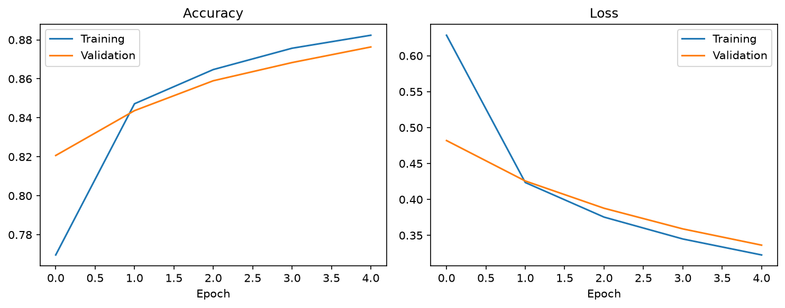
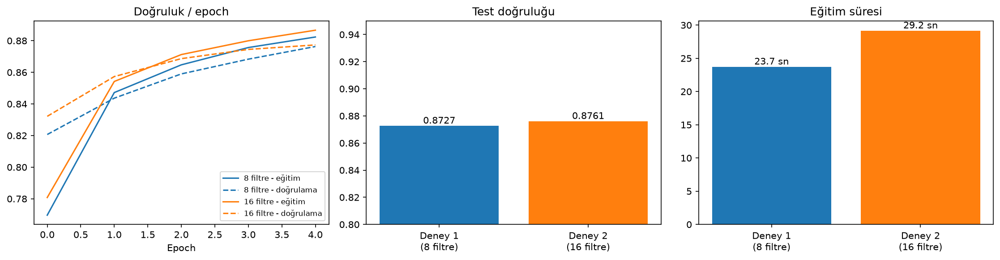

# Derin Öğrenme Ödevi

**Derin Öğrenme ve Evrişimsel Sinir Ağlarının (CNN) Temel Yapısının İncelenmesi**

| | |
|---|---|
| **Öğrenci** | Emine Baş |
| **Öğrenci No** | 02220224056 |
| **Ders** | Yazılım Mühendisliğinde Gelişmeler-3 |
| **Dil / Kütüphane** | Python · TensorFlow / Keras |
| **Veri seti** | Fashion-MNIST |

## İçerik

| Dosya | Açıklama |
|---|---|
| [`Derin_Ogrenme_Odevi_Rapor.docx`](Derin_Ogrenme_Odevi_Rapor.docx) | Word raporu: teorik soruların cevapları, kodlar, çıktılar, grafikler, deney ve değerlendirme |
| [`Derin_Ogrenme_Odevi_Sunum.pptx`](Derin_Ogrenme_Odevi_Sunum.pptx) | Derste sunum için 12 slaytlık PowerPoint (konuşmacı notları dahil) |
| [`CNN_Odevi.ipynb`](CNN_Odevi.ipynb) | Tüm bölümlerin kodu ve çıktıları (Jupyter Notebook, GitHub'da doğrudan görüntülenir) |
| [`cnn_odevi.py`](cnn_odevi.py) | Notebook'un düz Python sürümü |
| [`ciktilar/`](ciktilar/) | Filtre görselleri, pooling, eğitim grafikleri, karmaşıklık matrisi, deney karşılaştırması |

## Ödevin bölümleri

1. Ödevin amacı
2. Temel kavramlar: derin öğrenme, konvolüsyon, pooling, aktivasyon fonksiyonları, Dense katman
3. Konvolüsyon işleminin kodlanması ve 16 filtrenin görselleştirilmesi
4. Max Pooling işleminin incelenmesi (elle hesap ile program çıktısının karşılaştırılması)
5. ReLU ve Softmax fonksiyonlarının incelenmesi
6. Fashion-MNIST üzerinde basit bir CNN modelinin kurulması ve eğitilmesi
7. Model mimarisinin anlaşılması
8. Deney: ilk konvolüsyon katmanında 8 ve 16 filtre karşılaştırması
9. Değerlendirme ve sonuç

## Sonuçlar

| Ölçüt | Deney 1 | Deney 2 |
|---|---|---|
| Filtre sayısı (1. katman) | 8 | 16 |
| Toplam parametre | 27.562 | 28.794 |
| Eğitim doğruluğu | 0,8824 | 0,8866 |
| Test doğruluğu | **0,8727** | **0,8761** |
| Eğitim süresi (CPU) | 23,7 sn | 29,2 sn |

Filtre sayısını iki katına çıkarmak test doğruluğunu yalnızca 0,34 puan artırdı, eğitim süresini ise yaklaşık %23 uzattı. Yani daha fazla filtre her zaman orantılı bir kazanç sağlamıyor.




## Çalıştırma

```bash
python -m venv .venv
.venv\Scripts\activate          # Linux/macOS: source .venv/bin/activate
pip install -r requirements.txt
jupyter notebook CNN_Odevi.ipynb   # veya: python cnn_odevi.py
```

Fashion-MNIST veri seti ilk çalıştırmada Keras tarafından otomatik indirilir. Tüm eğitim CPU'da birkaç dakikada tamamlanır.
